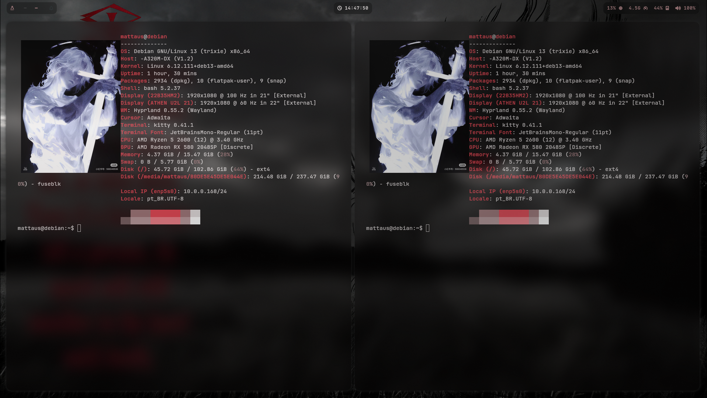
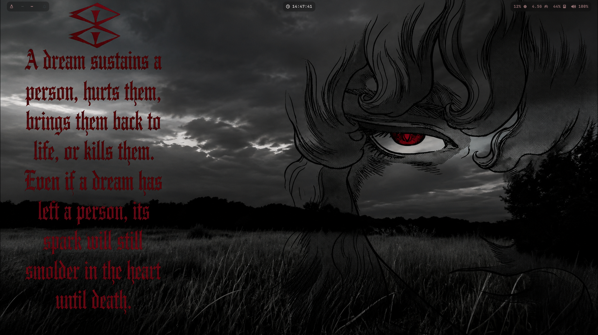
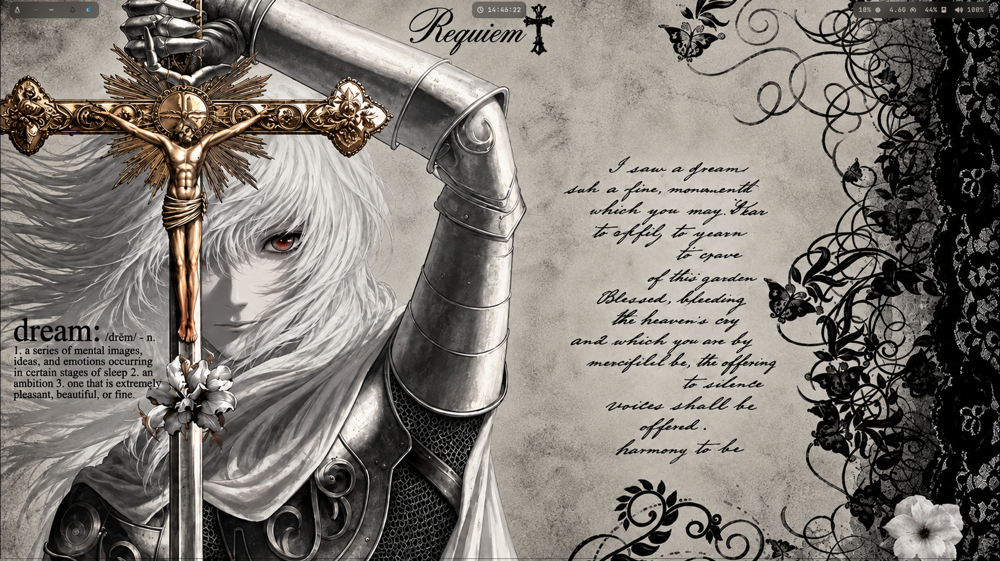

# Dotfiles do Hyprland

Configuracoes do meu desktop Debian/Hyprland, organizadas como pacotes para o
[GNU Stow](https://www.gnu.org/software/stow/).

## Capturas de tela







## Conteudo

- `hypr`: Hyprland em Lua, Hypridle, Hyprlock, scripts da sessao e observador de cores
- `waybar`: barra de status
- `kitty`: terminal
- `cava`: modelo de configuracao para o visualizador de audio
- `rofi`: launcher com cores do Pywal
- `wofi`: launcher de aplicativos com tema escuro e navegacao pelas setas
- `swaync`: central de notificacoes
- `waypaper`: seletor de wallpapers
- `fastfetch`: configuracao usada pelo dashboard
- `local-bin`: comandos auxiliares para bloqueio e wallpaper

Caches, estado local, binarios e wallpapers nao sao versionados. A tela de
bloqueio usa uma captura da tela para nao depender de uma imagem privada.

## Requisitos

Este setup usa uma versao do Hyprland com a API Lua global `hl`. Uma instalacao
padrao que aceite apenas `hyprland.conf` nao carregara `hyprland.lua`.

Dependencias principais:

```text
hyprland hypridle hyprlock waybar swaync kitty rofi wofi waypaper
swww pywal python3 python3-pil jq btop fastfetch cava yazi tty-clock unimatrix
pipewire wireplumber nautilus google-chrome-stable
grim slurp util-linux systemd
```

Tambem sao usadas as fontes JetBrains Mono, Symbols Nerd Font, FontAwesome,
Noto Sans e Noto Sans Mono CJK JP. O script `wal-palette.py` usa Pillow para
extrair as cores do wallpaper e Pywal para exportar a paleta. Imagens em tons
de cinza geram uma paleta monocromatica; imagens coloridas preservam seus tons
com ajustes de contraste para legibilidade.

## Instalacao

No Debian, instale primeiro o Stow:

```bash
sudo apt install stow
```

Clone o repositorio diretamente na sua pasta pessoal e crie os links:

```bash
git clone https://github.com/Mattaus-1/DebianM.git ~/dotfiles
cd ~/dotfiles
stow --target="$HOME" hypr waybar kitty cava rofi wofi swaync waypaper fastfetch local-bin
```

Se os caminhos de destino ja existirem como arquivos normais, faca backup e
remova-os antes de executar o Stow. Nao use `stow --adopt` sem revisar as
alteracoes, pois ele pode substituir o conteudo deste repositorio.

Para remover os links:

```bash
cd ~/dotfiles
stow --delete --target="$HOME" hypr waybar kitty cava rofi wofi swaync waypaper fastfetch local-bin
```

## Ajustes da maquina

Edite os monitores no inicio de `hypr/.config/hypr/hyprland.lua`. A configuracao
atual usa `DP-3` e `HDMI-A-1`, com dois workspaces em cada monitor.

`Super+Espaco` abre o Wofi. Use as setas para cima/baixo para selecionar um
aplicativo, Enter para abrir e Esc para fechar.

`Print` (ou `Fn+PrtSc`, dependendo do teclado) permite selecionar uma area com
o mouse usando Slurp e captura com Grim. Salva em `~/Imagens/Screenshots`, com
data e hora no nome do arquivo. Pressione Esc para cancelar.

`Super+scroll`, em qualquer direcao, alterna entre os dois workspaces do
monitor em foco. O script de alternancia nao adiciona trava nem espera.

O Waypaper procura imagens em `~/Imagens`. Depois de escolher um wallpaper, os
scripts geram a paleta em `~/.cache/wal` e atualizam Waybar, Rofi, Kitty, SwayNC,
Cava e btop. Execute o Waypaper uma vez apos instalar para criar esses arquivos de paleta.

O Waypaper abre centralizado em uma janela flutuante de 900x650, sem blur nem
sombra. O script `waybar-kitty-sync.py` aplica a paleta da Waybar aos sockets das
instancias abertas do Kitty, cria `~/.config/cava/config` a partir do modelo e
recarrega as cores do Cava. Para atualizar tambem
quando `colors-waybar.css` ou `style.css` for editado manualmente, ative o
observador do systemd:

```bash
systemctl --user daemon-reload
systemctl --user enable --now waybar-kitty-sync.path
```

A sincronizacao manual usa as declaracoes `@define-color`; cores literais
isoladas em regras CSS nao sao convertidas em cores do terminal.

Firefox, Zed, Spotify, Obsidian, Nautilus, Chrome e o dashboard usam opacidade
total. O Hyprlock envia automaticamente a entrada ao atingir quatro caracteres;
ajuste ou remova `auto_submit_length` em `hyprlock.conf` conforme sua senha.

O atalho `Super+Ctrl+D` abre o dashboard opcional e requer Fastfetch, Yazi,
tty-clock, Unimatrix e Cava.

## Atalhos recentes

- `Super+C`: abre Kitty e Cava em janelas flutuantes no monitor `DP-3`. O
  layout foi medido para 1920x1080; ajuste as coordenadas em
  `local-bin/.local/bin/abrir-terminal-cava` para outro monitor.
- `Super+F`: alterna tela cheia; `Super+M`: encerra a sessao do Hyprland.
- Clique em CPU ou memoria na Waybar: abre uma unica janela do btop; cliques
  seguintes focam a janela aberta.

O resumo Fastfetch no terminal usa o codigo ANSI `34`, que acompanha a cor
`color4` da paleta. Para exibi-lo ao iniciar um Bash interativo no Kitty,
adicione ao seu `~/.bashrc` se ainda nao houver uma chamada ao Fastfetch:

```bash
if [ -n "${KITTY_WINDOW_ID:-}" ] && command -v fastfetch >/dev/null 2>&1; then
    fastfetch --logo-color-1 34 --logo-color-2 34 --color 34
fi
```
